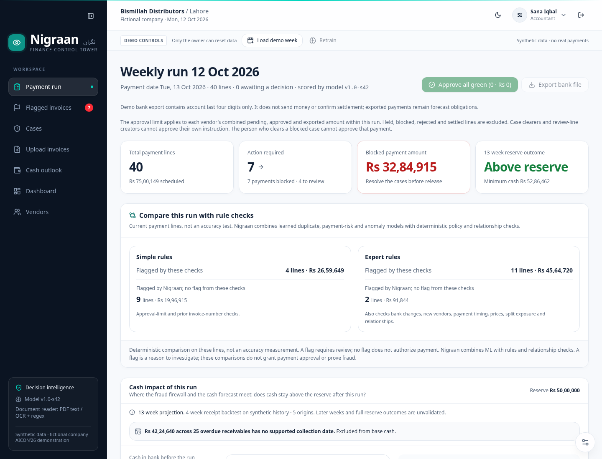
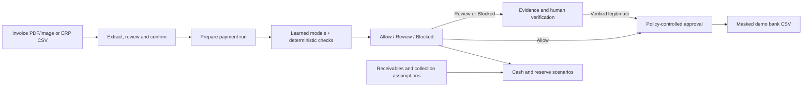

# Nigraan (نگران)

**Investigate before you pay. See the cash impact before you commit.**

Nigraan is a finance control tower for Pakistani small and medium-sized businesses. It helps an accountant prepare supplier payments, an approver investigate suspicious invoices, and an owner see whether upcoming collections can cover those payments.

It brings two questions into one workflow: **Should this payment go out, and can we afford it?**

Built for **AICON’26 · Build With AI · Financial Operations** by Mutahar and Uswa. The MVP uses a fictional distributor and synthetic data. It exports demo payment instructions; it does not transfer money.

[Demo frontend](https://nigraan-one.vercel.app) · [Quick start](#quick-start) · [Demo walkthrough](#demo-walkthrough) · [Evaluation](#evaluation) · [Testing](#testing) · [Documentation](#documentation)

## What Nigraan does

An SME can receive a duplicate invoice, a suspicious bank-change request or several payments that bypass an approval limit. Even legitimate bills can create a cash shortfall when customers pay late. Nigraan helps the team investigate those risks before approving a weekly payment run.



*Payment Run in the synthetic local demo. Amounts and payment states change with decisions; this screenshot shows a run after pending lines were decided.*

| Area | What you can do |
| --- | --- |
| **Payment Run** | See actual line counts, amounts needing attention and cash-reserve outcomes. Compare the hybrid detector with basic and expert rules; approve eligible lines and export a demo bank CSV. |
| **Flagged Invoices** | Search and filter payment lines, inspect evidence, approve eligible payments or hold them for investigation. |
| **Cases** | Review invoice pairs, bank history, relationship matches, model contributions and the audit trace. Record verification and a case outcome, with English/Roman Urdu support. |
| **Upload** | Extract fields from PDF/image invoices, inspect confidence, correct fields, match a vendor, confirm the invoice and score it. Sample files are included. |
| **Cash Outlook** | Inspect a 13-week projection, drill into daily movements and test collection scenarios without changing the ledger. Facts, estimates and assumptions are identified separately. |
| **Dashboard** | Review operational metrics and saved model evaluations with explicit synthetic-data and measurement-period labels. |
| **Vendors** | Create vendors, inspect history and request bank-detail changes that require independent approval. |

The interface includes a collapsible sidebar, mobile navigation, keyboard focus states, light/dark themes and reduced-motion support.

## Quick start

### Prerequisites

- **Python 3.11** and **Node.js 22**, matching the CI environment.
- Git and npm. PostgreSQL and Docker are optional; the default local database is SQLite.
- For scanned PDF extraction: **Tesseract** and **Poppler** (`pdftoppm`). Text PDFs and included samples can be used without a Gemini key.

The trained models and demo invoices are committed. **No training or cloud credentials are needed to start the local demo.**

Clone the repository:

```bash
git clone https://github.com/MuhammadMuthar/Nigraan.git
cd Nigraan
```

### Terminal 1: backend

From the repository root:

```bash
cd backend
python3.11 -m venv .venv
source .venv/bin/activate
python -m pip install -r requirements-dev.txt
python -m uvicorn app.main:app --reload --port 8000
```

On Windows, use a Python 3.11 interpreter to create the environment and activate it with `.venv\Scripts\Activate.ps1` in PowerShell.

The first startup seeds an empty database with the fictional company. Local state is stored in `backend/nigraan.db`. Keep this terminal running.

### Terminal 2: frontend

From the repository root:

```bash
cd frontend
npm ci
npm run dev
```

The frontend defaults to the API at `http://localhost:8000`. For a different backend, set `NEXT_PUBLIC_API_URL` in `frontend/.env.local` to the backend origin, without `/api/v1`, then restart Next.js.

| Local service | Address |
| --- | --- |
| Application | `http://localhost:3000` |
| Interactive API documentation | `http://localhost:8000/docs` |
| API health and model version | `http://localhost:8000/health` |

The API routes use the `/api/v1` prefix.

### Optional: API and PostgreSQL with Docker

From the repository root:

```bash
docker compose up --build
```

This starts PostgreSQL on port 5432 and the API on port 8000. Run the frontend separately using Terminal 2 above. Stop a native API using port 8000 before starting Compose. The API image includes Tesseract and Poppler; the Compose credentials are local demo credentials.

## Demo walkthrough

The seeded company is **Bismillah Distributors**. Its history and demonstration week are anchored to **12 October 2026**, rather than the computer’s current date.

All demo accounts use the password **`nigraan-demo`**. The login page provides shortcuts for the three main roles:

| User | Email | Role and principal actions |
| --- | --- | --- |
| Sana Iqbal | `sana@bismillah.pk` | **Accountant:** upload/correct invoices, prepare payment runs, create vendors and request bank changes. |
| Bilal Ahmed | `bilal@bismillah.pk` | **Approver:** approve eligible payments, resolve cases, approve another user’s bank change, export and retrain. |
| Haji Abdul Rashid | `rashid@bismillah.pk` | **Owner:** also prepare invoices/vendors, approve above-limit vendor commitments and reset the demo. |

A second accountant, `kashif@bismillah.pk`, is also seeded. Role permissions and independence checks apply to the owner too.

1. Sign in as **Rashid**, open **Demo controls** and select **Reset data**. Reset replaces the demo database and removes in-session work.
2. Sign out, sign in as **Sana** and select **Load demo week**. The included 40 invoices are imported and scored.
3. Open **Payment Run**, then **Flagged Invoices**. Read the current counts, blocked amount and reserve result; they change with decisions and model state.
4. Open one blocked **Case**. Inspect its evidence and model contributions, verification checklist, score breakdown and English/Roman Urdu explanation.
5. Use an **Approver/Owner** session to record a verification method, checks, reference, finding and outcome. Describe any demonstration finding as synthetic. Use a different person to approve a payment whose case was cleared.
6. Approve eligible lines and hold other pending lines. Export becomes available when no pending line needs a decision and at least one line is approved.
7. In **Upload**, try an included sample, review confidence and extracted fields, confirm when prompted, then inspect the score. The resent sample demonstrates duplicate detection.
8. In **Cash Outlook**, drill into a week and test a collection-date assumption. Finish on **Dashboard** to inspect the evaluation and its limits.

**Payment safeguards:** review-line creators cannot approve their own line; a false-alarm clearer cannot approve that payment. Combined vendor commitments above **PKR 500,000** within the current run require owner approval. These commitments include pending, approved and exported lines. A green classification is not payment approval.

**Bank export:** the CSV contains account last-four digits and demo instructions. It does not send money or confirm settlement. Exported amounts remain outstanding in the cash forecast.

Prepare reset/load before a presentation timer starts. Keep retraining outside the timed demo: it changes the runtime model version and invalidates the saved review study for that runtime. Reset reloads the shipped models. See the [presentation guide](docs/demo-guide.md) for a complete product demonstration and pilot plan.

## How AI and controls work together



| Component | Method | Purpose |
| --- | --- | --- |
| Duplicate detector | Logistic regression on invoice-pair features | Compare similar invoice numbers, amounts, dates and line items. |
| Behavioural risk | XGBoost with feature-contribution reasons | Assess combinations of signals such as timing, vendor history and bank changes. |
| Anomaly detector | Isolation Forest | Identify unusual payment behaviour. |
| Relationship evidence | Deterministic NetworkX matching | Trace shared identifiers and relationships that require investigation. |
| Policy and fusion | Deterministic rules plus calibrated engine signals | Combine evidence into a risk score and enforce known blocking rules. |
| Late-payment risk | XGBoost | Prioritize receivables likely to be paid late. Collection dates use explicit historical-delay assumptions. |
| Cash calculation | Deterministic daily arithmetic | Project cash movements and reserve breaches over 13 weeks. |
| Document extraction and explanations | Optional Gemini, validators and labelled fallbacks | Read documents and explain structured evidence. |

The displayed risk score is **not a fraud probability**. Its bands are Allow below 40, Review from 40 to below 75, and Blocked from 75; hard rules can force a block. Relationship matches are evidence to investigate, not proof of wrongdoing.

Gemini does not calculate risk scores, cash balances or payment permissions. Without a key, extraction uses PDF text/OCR and regex; explanations use a labelled template fallback. Model evidence and generated summaries remain distinct.

Resolved case outcomes provide labels for approver/owner-triggered retraining of the fraud engines. The retraining flow writes runtime artifacts separately from the committed models and reports a new model version.

## Evaluation

**All results below use synthetic data. They do not establish real-world fraud accuracy, customer savings or production readiness.**

The fraud models train on **October 2025–July 2026** (months 1–10), with out-of-time tuning folds. The held-out set covers **August–September 2026** (months 11–12): **638 payments, including 22 planted frauds and 616 legitimate payments**.

| Held-out result | Nigraan | Expert rules | Simple rules |
| --- | --- | --- | --- |
| Planted frauds flagged for review or blocking | **22/22 (100%)** | 19/22 (86.4%) | 5/22 (22.7%) |
| Legitimate payments flagged | **22/616 (3.6%)** | 147/616 (23.9%) | 20/616 (3.2%) |
| Precision among all alerts | **50.0%** | 11.4% | 20.0% |

Nigraan blocked **21/22 planted frauds (95.5%)**. Precision among blocked lines was also **95.5%**. Flagging and blocking are different outcomes; an alert still requires investigation.

Simple rules check normalized duplicate numbers and the individual approval limit. Expert rules also check recent bank changes, new vendors, night entry, price changes, combined exposure and deterministic policy/relationship evidence. These broad expert checks were not tuned to match Nigraan’s false-alarm rate; the comparison does not establish superiority to every possible rules system.

Additional measurements:

- **Invoice-age sensitivity:** an offline refit without invoice age still flagged 22/22, with 4.1% false alarms. Other synthetic correlations may remain.
- **Late-payment ranking:** held-out PR-AUC 0.91, versus 0.57 for the late-rate baseline. This measures ranking, not collection-date accuracy.
- **Cash receipts:** the current conservative policy reduced four-week mean absolute weekly receipt error by **15.2%**, from about **PKR 25.9 lakh to PKR 22.0 lakh**, across five rolling origins. This does not validate 13-week balances or reserve outcomes. The older 41% result used a different collection policy.
- **Document extraction:** the regex fallback achieved 100% field accuracy on the 40 demo PDFs it was designed for. This demonstrates the pipeline, not unseen-layout or Gemini accuracy.

Sources: [main metrics](models/metrics.json), [expert comparison and age study](models/review_eval.json), [cash-policy comparison](models/cash_review_metrics.json), [extraction evaluation](models/extraction_eval.json) and [model card](docs/model_card.md). Saved results describe their evaluated artifacts; they are not live performance estimates after retraining.

## Testing

Backend tests, from `backend/` with its virtual environment active:

```bash
python -m pytest -q
```

Frontend checks, from `frontend/`:

```bash
npm run typecheck
npm run lint
npm run build
```

For browser tests, start in the repository root. Activate the backend environment so Playwright’s API command can find the installed Python dependencies:

```bash
source backend/.venv/bin/activate
cd frontend
npm run build
npx playwright install chromium
npm run test:e2e
```

Playwright starts the API and built Next.js app, or reuses servers already on ports 8000/3000. The suite covers login, reset/load, evidence, verification, approvals, upload, vendor workflows, cash scenarios, dashboard and navigation. **It resets and changes the connected demo data**, so use disposable local state rather than an active presentation session.

Backend tests use temporary SQLite by default. `TEST_DATABASE_URL` selects PostgreSQL; the test reset replaces that database’s application tables, so use a dedicated test database. An existing Chromium installation can be selected with `PW_CHROMIUM`.

[GitHub Actions](.github/workflows/ci.yml) runs backend tests and frontend typecheck, lint and build. Browser tests are currently separate. See the [dated implementation and validation report](docs/review-implementation.md) for recorded results.

## Configuration

Backend settings read the root `.env`, then `backend/.env`; process environment variables take precedence. Frontend settings belong in `frontend/.env.local` or the deployment platform. [.env.example](.env.example) lists common settings; replace its example secrets before a nonlocal deployment.

| Variable | Default or purpose |
| --- | --- |
| `DATABASE_URL` | SQLite in `backend/nigraan.db`; PostgreSQL is supported. |
| `JWT_SECRET` | Development-only default; use a generated secret for deployment. Render’s blueprint generates one. |
| `DEMO_MODE` | `true`; enables demo reset/load controls. |
| `AUTO_SEED` | `true`; seeds an empty database at startup. |
| `ALLOWED_ORIGIN` | `http://localhost:3000`; accepts comma-separated frontend origins. |
| `GEMINI_API_KEY` | Optional; enables Gemini extraction and summaries. |
| `GEMINI_MODEL` | `gemini-2.5-flash`. |
| `AI_TIMEOUT_S` | `8`; Gemini timeout per attempt. |
| `SEED` | `42`; seed used when resetting or automatically seeding the synthetic company. |
| `HASH_SALT` | Process environment only; defaults to `nigraan-demo-salt` for the stock demo. |
| `NEXT_PUBLIC_API_URL` | Frontend API origin; defaults to `http://localhost:8000`. Do not append `/api/v1`. |

`HASH_SALT` is read directly from the process environment, not the settings `.env` files. Leave its stock default for the included demo; a custom value must be supplied consistently when generating and using matching data/artifacts. Do not copy the example `change-me` value as a deployment secret.

`DEMO_MODE=false` hides/disables demo reset/load; it does **not** remove seeded public accounts or disable automatic seeding. A real-data deployment requires separate provisioning and security work.

## Deployment

**API on Render:** import [render.yaml](render.yaml) as a Blueprint. It creates the Docker API and PostgreSQL database. Set `ALLOWED_ORIGIN` to the actual frontend origin; the value in the blueprint must be checked. Gemini is optional. Confirm `/health` and `/docs` after startup.

**Frontend on Vercel:** import the repository with **Root Directory `frontend`**. Set `NEXT_PUBLIC_API_URL` to the deployed API origin before building. Redeploy after changing that value, then verify login and the full demo flow against the deployed API.

The API Docker image intentionally runs one worker: model/cache and retraining job state live in the process. Public hosting requires persistent database storage and an instance ready before the presentation. Deployment configuration alone does not verify the hosted application.

## Troubleshooting

| Symptom | Check |
| --- | --- |
| “Cannot reach the Nigraan API” | Request `/health`, check API logs and `NEXT_PUBLIC_API_URL`. For a different frontend origin, check `ALLOWED_ORIGIN`. |
| Demo week is already open | Preserve any work you need, then reset as the owner before loading again. |
| Approval is refused | Check role, review-line creator, case clearer and combined vendor amount. Switch to an eligible independent approver. |
| Reserve falls below the limit | Inspect real projected outflows and excluded unconfirmed collections. A low-risk payment can still create a cash shortfall. |
| Scanned PDF does not extract | Install Tesseract and Poppler, or use the Docker API. Check the displayed extraction engine and field confidence. |
| Playwright cannot start | Build the frontend, activate backend Python and install Chromium. Check whether existing ports point to disposable demo servers. |
| Saved study disappears after retraining | The study no longer matches the runtime artifacts. Reset to reload the shipped model for that demonstration. |

## Data and current limits

The included company, people, vendors, invoices and fraud labels are synthetic. Financial calculations use **integer paisa**, with rupee/lakh formatting at the interface. Timestamps are stored in UTC and displayed in **Asia/Karachi**.

Application database identity fields use salted CNIC/IBAN hashes and account suffixes. Synthetic source documents and fixtures can contain full fictional identifiers. This is not a claim that real uploads are anonymized or that the prototype meets a production security standard.

Unconfirmed overdue collections without a supported future date are excluded from base cash. A What-if scenario can explicitly date them as an assumption; it does not edit the ledger or guarantee the reserve.

The MVP has role permissions, independent approval checks and an inspectable audit history. It has no bank settlement integration or tamper-proof audit store. Real customer validation, security hardening, data governance and forecast validation remain next steps.

The proposed first pilot is a distributor’s weekly payment process, measured by review time, useful alerts and receipt forecast error. Customer savings, pricing and adoption are unvalidated. Stronger SME controls could support SDG 8.3 and 16.4; this is intended impact, not a measured outcome.

## Documentation

| Resource | Purpose |
| --- | --- |
| [Architecture](docs/architecture.md) | Services, data flow and API design. |
| [Model card](docs/model_card.md) | Training, evaluation, features, ablations and limitations. |
| [Design decisions](docs/decisions.md) | Implementation choices and tradeoffs. |
| [Demo guide](docs/demo-guide.md) | Product demonstration, judging evidence and pilot hypotheses. |
| [Review and validation](docs/review-implementation.md) | Dated changes, measured results, checks and remaining gaps. |
| [Frontend guide](frontend/README.md) | Routes and display preferences. |

```text
backend/       FastAPI app, synthetic data generation, ML training/evaluation, tests
frontend/      Next.js 16, React, TypeScript, Tailwind, Radix, charts and Playwright
models/        Committed model artifacts and evaluation reports
demo_week/     Demo invoices, ERP CSV, sample uploads and synthetic ground truth
docs/          Architecture, model card, decisions and demonstration guides
.github/       Continuous integration workflow
```

<details>
<summary><strong>Advanced: regenerate synthetic data, models and reports</strong></summary>

These steps are optional and separate from the quick start. Run from `backend/` with its virtual environment active:

```bash
python -m data_gen.generate_company --seed 42 --no-db
python -m data_gen.render_pdfs --seed 42
python -m ml.train_all --seed 42
python -m ml.eval_extraction
python -m ml.evaluate --months 11-12 --seeds 42,43,44,45,46
python -m ml.review_evaluate
python -m ml.cash_review
```

`--no-db` writes hidden evaluation data without replacing the database. Omitting it drops/recreates the configured database’s application tables. PDF generation replaces demo assets; training replaces committed model artifacts by default; evaluation updates reports, caches and plots. Inspect the diff before committing generated files. The review study refits comparison models in memory without replacing the shipped engines.

</details>

## Contributing and team

Use a focused branch, explain the problem and resulting behavior, and run checks appropriate to the change. Preserve exact money calculations, approval separation and the distinction between evidence, model scores and generated explanations. Follow [frontend/AGENTS.md](frontend/AGENTS.md) when changing Next.js code, including its requirement to read the installed version’s local documentation.

- **Mutahar:** integration, frontend and deployment.
- **Uswa:** data, ML, evaluation and presentation.

The repository currently has no `LICENSE` file.
