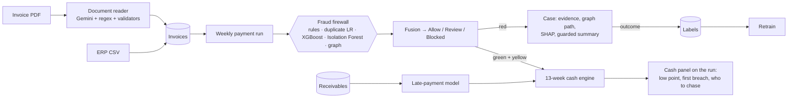

# Nigraan (نگران): finance control tower for Pakistani SMEs

**Nigraan checks every rupee going out, and tells you whether what's coming in will cover it.**

Before the weekly payment run, every vendor payment gets a green / yellow / red verdict with reasons from an AI fraud firewall. The owner also sees whether cash stays above the reserve for the next 13 weeks, using a receivables model that predicts who will pay late.

- **Live app:** `https://<your-vercel-app>.vercel.app` *(set after deploy, see [Deploy](#deploy))*
- **API docs (the contract):** `https://<your-render-api>.onrender.com/docs`
- **Demo video:** *(link placeholder)*
- AICON'26 Build With AI · Financial Operations · team: Mutahar, Uswa

## Try the demo week (2 minutes)

1. Open the live app. On the login page, click **Sana Iqbal (Accountant)**. Password for all demo users: `nigraan-demo`.

   | User | Role | Can |
   |---|---|---|
   | sana@bismillah.pk | Accountant | enter invoices, prepare the run |
   | bilal@bismillah.pk | Approver | approve green, second-approve yellow, resolve cases |
   | rashid@bismillah.pk | Owner | everything, including payments above the Rs 5 lakh limit |

2. In the **Demo** bar, click **Reset data**, then **Load demo week**. Forty vendor invoices are imported and every line is scored in about a second.
3. **Payment run.** Read the cash panel first:
   - *With Nigraan*, cash stays above the Rs 50 lakh reserve for 13 weeks.
   - *If every line were released*, it breaches the reserve on Tue 13 Oct.

   Below the panel, *Needs your attention* previews the riskiest lines.
4. Open **Flagged invoices** in the left menu (the red badge counts lines awaiting a decision): 7 red lines (locked, *View case*) and a few yellow lines (second approver); the *Allow* and *All* filters show the green lines. Click a line for the evidence drawer, or **View case** on a red line. The evidence depends on the pattern:
   - duplicate invoices side by side;
   - the bank-change timeline;
   - the vendor → phone → employee graph path (animated, labels never covered by lines);
   - SHAP reason bars, a guarded summary, the suggested verification step, and the full agent trace with timings.
5. Sign out, sign in as **Haji Abdul Rashid (Owner)**. Then:
   - **Approve all green**;
   - **Confirm fraud** on a case;
   - **Retrain**: the case outcome becomes a label and the model version bumps.
6. **Upload invoices.** Click a sample (no files needed). Fields fill in with per-field confidence, and the re-sent invoice is blocked as an exact duplicate.
7. **Cash outlook.** 13-week chart (facts, model estimates and assumptions shown differently), daily drill-down, receivables by late risk, and a *What if* that moves a collection.
8. **Dashboard.** Rupees protected, open cases, alerts by pattern, and model metrics vs baseline.

## The problem

- **Fraud.** Occupational fraud costs organisations about **5% of revenue** a year, and the typical scheme runs about **12 months** before it is detected (ACFE, *Occupational Fraud 2024: A Report to the Nations*). Small businesses lose a larger share because they have fewer controls. In a Pakistani SME the same 3-4 people enter invoices, change vendor bank details and approve the weekly run, often on WhatsApp at night.
- **Cash.** Distributors sell on 15-45 day credit to kiryana stores and wholesalers who pay late, especially around Eid. A payment run that looks affordable on Monday can push cash below the reserve before Friday.
- **Digitisation.** FBR's e-invoicing and POS integration push SMEs toward digital invoices. The data now exists to check every payment, but nobody has time to read it.

## What makes it AI-native

The product cannot work without the models; ML and deterministic code make every decision. The LLM only reads documents and writes explanations.

| Component | Model | Why AI and not a rule |
|---|---|---|
| Duplicate detector | Logistic regression on invoice-pair features (normalised-number similarity, date gap, amount difference, line-item overlap, TF-IDF char n-grams) | Catches `INV-0102` vs `INV-102` with a 0.5% change, while ignoring legit weekly standing orders that exact-match rules confuse |
| Risk model | XGBoost on 27 leakage-safe behaviour features, with SHAP reasons mapped to plain English ("Bank account changed 2 hours before this payment") | Fraud is a combination of weak signals: timing, bank changes, price vs history, approval-limit gaps |
| Anomaly detector | Isolation Forest | Unseen patterns |
| Relationship graph | NetworkX over vendors, employees, users, bank/CNIC hashes, phones, addresses (time-valid edges) | Shell vendors share an identifier with an employee; disclosed related parties are down-weighted |
| Fusion | Weighted engine signals calibrated on out-of-time folds; hard rules can force a block | One explainable risk score, fixed bands at 40 / 75; not a probability |
| Late-payment model | XGBoost vs logistic regression vs baseline (shipped XGBoost on validation PR-AUC) | Predicts at issue date which receivables will be paid late |
| Cash engine | Deterministic daily engine, 13 weeks | Facts and estimates stay separate; mid-week breaches are caught |
| Document reader | Gemini Flash with a strict JSON schema, cross-checked by PDF text/OCR + regex and validators | The LLM reads documents; deterministic agreement sets the confidence |
| Case summary | Gemini, structured evidence only, number-check guardrail | Explanations for approvers; never a score |

Learning loop: case outcomes (confirmed fraud / false alarm) become labels, and **Retrain** refits the engines and bumps `model_version`.

## Architecture



More in [docs/architecture.md](docs/architecture.md).

## Evaluation: how we measured, and against what

`python -m ml.evaluate --months 11-12 --seeds 42,43,44,45,46` writes [models/metrics.json](models/metrics.json) plus [docs/confusion_matrix.png](docs/confusion_matrix.png) and [docs/pr_curve.png](docs/pr_curve.png). Models train on months 1-10 and are tested on **months 11-12, which they never saw**. Every number on our slides comes from that file.

**Fraud firewall** (638 payments, 22 planted frauds):

| | Nigraan | Rules-only baseline |
|---|---|---|
| Fraud caught (yellow or red) | **100%** | 22.7% |
| Caught at red (blocked) | **95.5%** | 22.7% |
| Precision at red | **95.5%** | 20.0% |
| False-alarm rate | **3.6%** | 3.2% |
| PR-AUC | **0.993** | 0.07 |
| Rupees blocked | **Rs 53.5 lakh of Rs 54.3 lakh** | Rs 12.6 lakh |

The rules-only baseline flags exact duplicate numbers and amounts over the approval limit.

**Robustness.** Across 5 different synthetic companies (90 frauds): 100% caught, 97.8% at red, 2.4% false alarms. Every fraud type is above the 70% target.

**Late payments.** PR-AUC 0.91 vs 0.57 for the late-rate baseline (logistic regression 0.89). 99% of the riskiest 20% really were late.

**Cash forecast.** 41% lower weekly error than "everyone pays on the due date" (Rs 35.4 lakh vs Rs 60.4 lakh mean absolute error per week).

**Document reader.** 100% field accuracy on the 40 demo PDFs with the regex fallback. That fallback was written for these layouts, so this proves the pipeline only.

Full details, ablations and limitations: [docs/model_card.md](docs/model_card.md). Judgement calls: [docs/decisions.md](docs/decisions.md).

## Impact (assumptions, stated)

- **Time.** A weekly run of ~80 lines takes an accountant and approver about 2 hours to cross-check by hand (vendor history, bank letters, duplicates). Nigraan auto-clears most lines as green: about 95% of a normal week in the backtest, and 29 of 40 in the fraud-seeded demo week. Review then focuses on the rest, which we estimate saves 60-90 minutes a week. This is an assumption to validate in a pilot.
- **Money.** In the held-out months, Nigraan would have blocked **Rs 53.5 lakh** of planted fraud at red, vs Rs 12.6 lakh for rules-only. On the demo week it blocks Rs 32.8 lakh and keeps cash above the reserve, when releasing everything would breach it.
- **SDGs.**
  - **8.3**: helps micro and small enterprises formalise and grow, with digital financial controls they can afford.
  - **8.10**: strengthens the capacity of domestic financial institutions and SMEs to use financial services safely.
  - **16.4**: reduces illicit financial flows, here internal fraud and payment diversion.

## Data

100% synthetic, from `python -m data_gen.generate_company --seed 42`: a fictional company, fictional people and fictional vendors. CNICs and IBANs are stored only as salted SHA-256 hashes plus the last 4 digits. Money is integer paisa. Timestamps are stored in UTC and displayed in Asia/Karachi.

## Run locally

```bash
# backend (Python 3.11)
cd backend
python -m venv .venv && . .venv/bin/activate
pip install -r requirements-dev.txt
uvicorn app.main:app --port 8000          # seeds the company on first start (~5 s)
pytest -q                                  # 22 tests; TEST_DATABASE_URL=postgresql://... for Postgres

# frontend (Node 22)
cd ../frontend
npm install
echo "NEXT_PUBLIC_API_URL=http://localhost:8000" > .env.local
npm run dev                                # http://localhost:3000
npx playwright test                        # happy-path e2e (starts both servers if needed)
```

Rebuild the data, models and metrics:

```bash
cd backend
python -m data_gen.generate_company --seed 42   # DB + hidden labels in data_out/
python -m data_gen.render_pdfs --seed 42        # demo_week/ PDFs, CSV, ground truth
python -m ml.train_all --seed 42                # models/
python -m ml.eval_extraction                    # models/extraction_eval.json
python -m ml.evaluate --months 11-12 --seeds 42,43,44,45,46
```

## Deploy

For a five-minute presentation and release checks, use [the demo guide](docs/demo-guide.md). Public deployment/video links above still need verified URLs; the repository does not imply a deployed app or customer pilot.

Bank export is a **demo CSV**, containing only account last four digits. It neither sends money nor confirms settlement. Exported payments remain outstanding in the cash forecast; historical `released` payments represent seeded settlements. There is no bank settlement integration.

Local scanned-PDF extraction needs **Tesseract** and **Poppler (`pdftoppm`)**, included in the API Docker image. The fallback processes at most 10 pages with bounded render/OCR time. Gemini remains optional; template summaries are explicitly labelled when it is unavailable.

**API on Render.**
1. New → Blueprint → select this repo. `render.yaml` creates `nigraan-api` (Docker, `backend/Dockerfile`) and a Postgres database.
2. Set `ALLOWED_ORIGIN` to your Vercel URL. Optionally set `GEMINI_API_KEY`.
3. The first boot seeds the company. Use a paid instance (starter) so the service does not sleep before the judging deadline.

**Frontend on Vercel.**
1. New Project → import this repo → **Root Directory `frontend`**.
2. Set the env var `NEXT_PUBLIC_API_URL=https://<your-render-api>.onrender.com`.
3. Deploy.

Environment variables are listed in [.env.example](.env.example): `DATABASE_URL`, `GEMINI_API_KEY`, `JWT_SECRET`, `DEMO_MODE`, `ALLOWED_ORIGIN`, `NEXT_PUBLIC_API_URL`.

## Repository

```
backend/   FastAPI app (app/), synthetic data generator (data_gen/), training & evaluation (ml/), tests/
frontend/  Next.js 16 + Tailwind + Radix/shadcn-style UI, Recharts, react-force-graph, Playwright e2e
models/    trained artifacts + metrics.json (committed, small)
demo_week/ 40 invoice PDFs, ERP CSV, extraction ground truth, upload samples
docs/      model card, architecture, decisions, evaluation plots
```

## Team & disclosure

- **Mutahar**: integration, frontend, deploy.
- **Uswa**: data, ML, evaluation, deck.

Agent tooling/config prepared before the event; all application code written during AICON'26.
